# Community media and Art tab evidence (0.8.3)

This packet records rendered browser checks against local production web artifacts, using deterministic API and media fixtures. The Art-tab video run used immutable artifact `C:\kubus-build\083-web-3f6ee7bd`; its source report is `output/playwright/083-art-video-corrected/report.json`. The hashtag-state run used `C:\kubus-build\083-web-c5e1c419`; its source report is `output/playwright/083-art-hashtag-states/report.json`. The four geometry reports (`output/playwright/083-shapes-v2/{portrait,landscape,square,ultrawide}/report.json`) each name `C:\kubus-build\083-community\build\web` as their `webRoot`, so they are recorded separately as a mutable local build artifact rather than attributed to either immutable artifact. This evidence does not establish live backend acceptance, deployment, or release readiness.

## Video geometry, playback, and fullscreen

The four shape reports are under `output/playwright/083-shapes-v2/{portrait,landscape,square,ultrawide}/report.json`. Chromium and Firefox each exercised all four shapes in light and dark themes, English (US), reduced motion. At the fresh 390 px viewport, each browser/shape run recorded active unmuted fixture playback (`paused=false`, `readyState=4`), continued playback, and successful fullscreen entry. The seven widths (320, 360, 390, 430, 768, 1440, and 1920 px) are resized layout/overflow captures only; playback and fullscreen were not rerun at every width, and wide viewport resizing can cross back into the app shell. These checks used fixture media (portrait 180×320, landscape 320×180, square 240×240, ultrawide 420×180), not user uploads or a live service.

Representative rendered captures:

| Shape | Capture |
| --- | --- |
| Portrait | 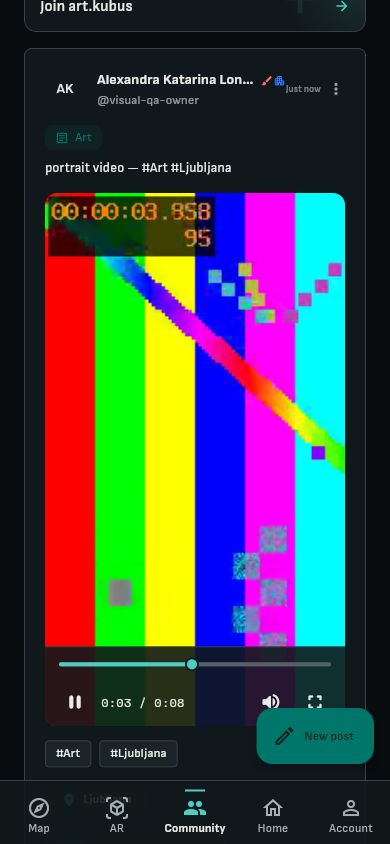 |
| Landscape | 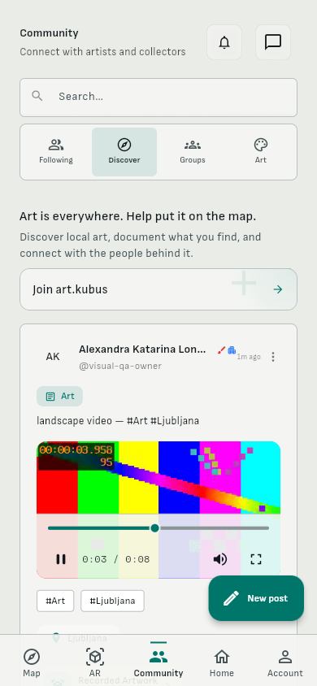 |
| Square | 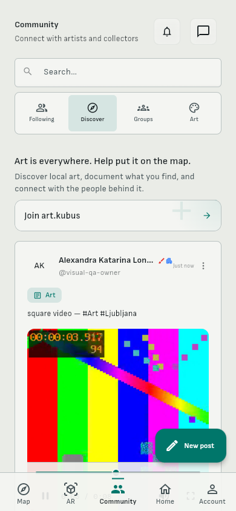 |
| Ultrawide | 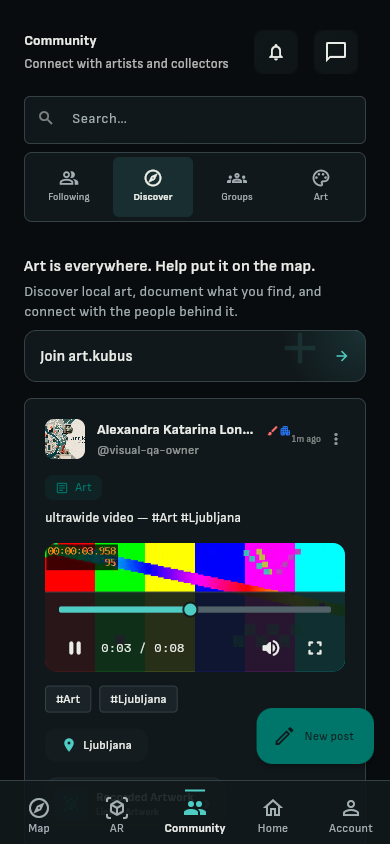 |

The Art-tab video route was checked at a fresh 390 px viewport in Chromium and Firefox against immutable artifact `C:\kubus-build\083-web-3f6ee7bd`. Both runs report active, unmuted fixture playback with no browser errors; see `output/playwright/083-art-video-corrected/report.json`. This report does not claim fullscreen or playback at the other resized widths.

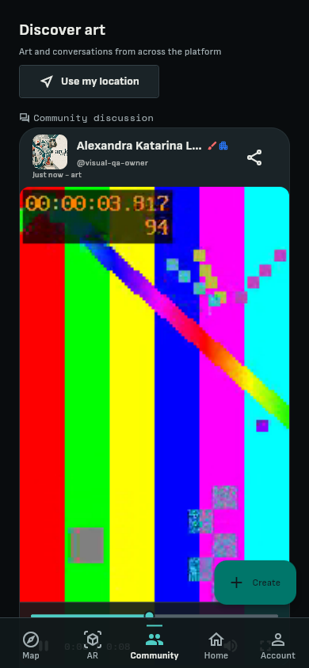

## Hashtag contrast and interaction states

`output/playwright/083-rerun-art-hashtag/report.json` records Chromium and Firefox light and dark theme captures of normal, hover, keyboard focus, and selected/filter states at 390 px, using immutable artifact `C:\kubus-build\083-web-90200b56`. The earlier Firefox attempt in `083-art-hashtag-states` failed because the chip was outside the visible/semantic target; the corrected rerun passes in both Firefox themes. The following representative set shows Chromium and Firefox light-theme states:

| State | Capture |
| --- | --- |
| Normal | 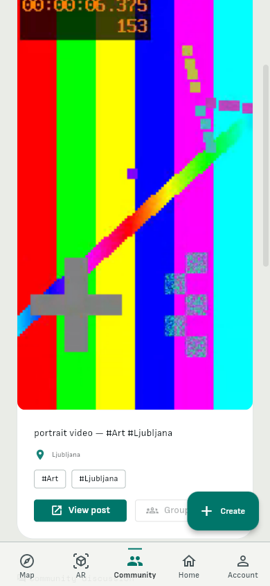 |
| Hover | 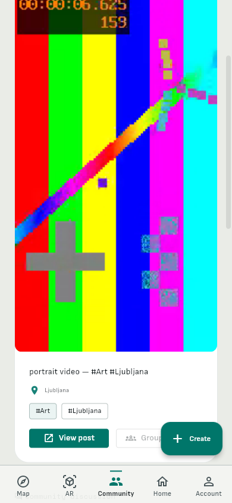 |
| Keyboard focus | 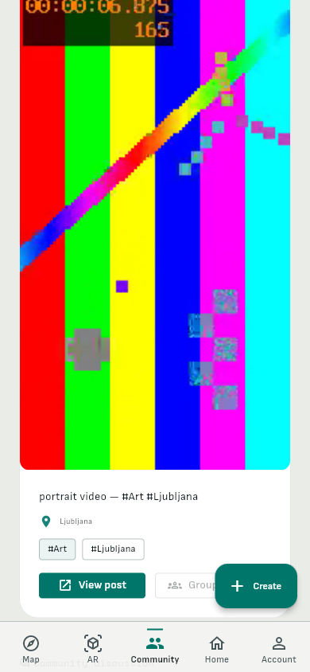 |
| Selected/filter | 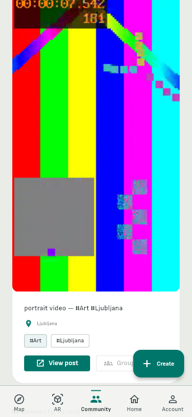 |
| Firefox normal |  |
| Firefox hover | 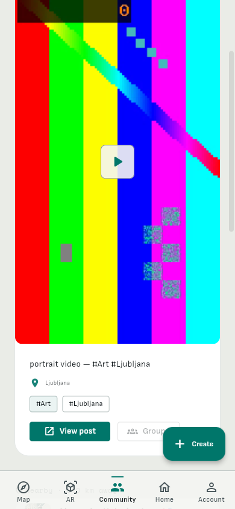 |
| Firefox keyboard focus |  |
| Firefox selected/filter | 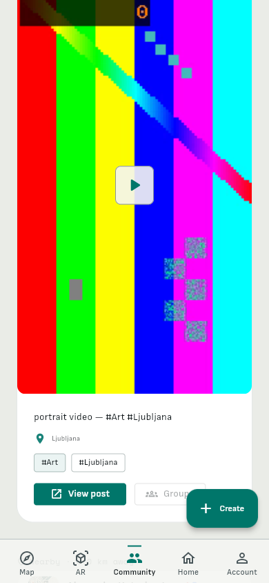 |

## Community media hosts

Corrected host checks use the immutable artifact `C:\kubus-build\083-web-90200b56` and deterministic local fixtures. The post-detail report is `output/playwright/083-host-post-detail/report.json`; profile posts after the Posts action are `output/083-profile-stage-diagnostic/report.json`; the fresh group-feed run is `output/playwright/083-group-feed-final/report.json`. The group route was reached through the Groups tab and accessible “Open group feed” action. The browser recorded `GET /api/groups?page=1&limit=20` followed by `GET /api/groups/{fixture-id}/posts?page=1&limit=30`; the screen showed heading “Fixture Group”, then the Visitor Artist portrait post and its media player. These routes and response shapes match `BackendApiService.listCommunityGroups` and `getGroupPosts` and the `CommunityGroupSummary` parser. Mixed video/image carousel playback is `output/playwright/083-mixed-media-stage/report.json`, and the corrected quoted/repost fixture is `output/playwright/083-quoted-media-corrected/report.json`. Chromium and Firefox at fresh dark 390 px showed active, unmuted video advancing for two seconds, and fullscreen controls changed to “Exit full screen” in each report. The mixed initial accessibility tree identifies `Media 1 of 2`, but the portrait video was visibly narrow inside a square 225×225 stage in this pre-fix artifact. A focused carousel fix now sizes active video slides from each URL's initially captured aspect and preserves the established image policy; rebuilt-artifact acceptance follows in [Mixed carousel acceptance](#mixed-carousel-acceptance). The quoted tree identifies the outer “Quoted art video” and nested “Original portrait video” by Visitor Artist; its compact stage does not expose a separate Media N of N label. These host reports establish fixture playback at 390 px only; they do not establish live backend behavior or playback at all widths.

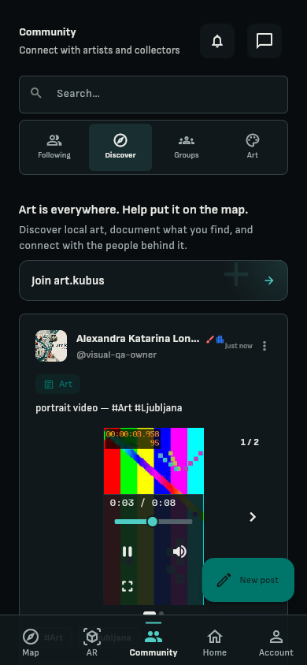
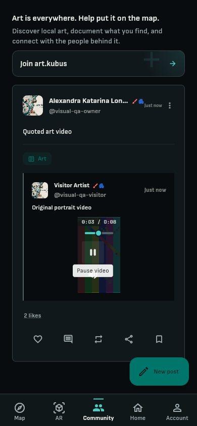

## Limits and provenance

- The fixture runs block or stub write requests and do not submit Community content. API payloads and media are deterministic; no authenticated live Art feed was validated here.
- Cold legacy videos without a stored or supplied geometry hint still use the stable 16:9 fallback. Physical-device playback and audio acceptance remain pending.
- The user's three reported screenshots were not available in the workspace. Existing `G:/WorkingDATA/art.kubus/output/playwright/community-083-before-*` images are worker captures and are not treated as user-provided or approved baseline evidence.
- This packet includes a small sample of rendered screenshots; the source reports and full width/theme/browser captures remain in the checkout's `output/playwright` directories.

## Mixed carousel acceptance

Source `ed7e6411` (PR #301 head), local release web build with
`--dart-define=COMMUNITY_MULTI_MEDIA_ENABLED=true`, `main.dart.js` SHA256
`20aec7bcf597eb24b4ca28cf4e1db5236ee6cd09eaccb0de3951d3aa072dd31c`. That define is
required: release builds default the flag off, and a post then shows only its first
item (an earlier run without it rendered "Media 1 of 1" for a two-item post, which
is the documented flag behavior and not a carousel defect). Chromium and Firefox,
light, English, normal motion, widths 320, 390 and 1440, deterministic local
fixtures. Reports: [portrait to landscape clip](reports/mixed-video-pair-ed7e6411-083-web-mm.json),
[portrait clip to image](reports/mixed-video-image-ed7e6411-083-web-mm.json).

Stage contract: the stage follows the active slide (images keep the 4:3 stage; a clip
uses its frozen aspect, capped to the usable viewport, with the stable 16:9 fallback
when none is known) and eases once for that page change; metadata arriving after
first paint never moves it, and reduced motion changes shape without easing.

Superseded before release (review of PR #306): the measurements below were taken
with a stage that followed the active slide. That contradicted the design
contract that mixed carousels keep one 4:3 stage, because swiping resized the
feed. The final contract is: only a post whose single item is a video adapts its
stage to the clip; every multi-item carousel keeps one 4:3 stage on every page,
and a clip that does not fit is contained and opens fullscreen from its controls.
The tables below therefore show the replaced geometry and are kept as history.

| Width | Portrait to landscape clip | Back to portrait | Portrait clip to image |
| --- | --- | --- | --- |
| 320 | stage 230x129, video 230x129 | 230x409, video 230x409 | image stage 230x173, no player |
| 390 | stage 300x169, video 300x169 | 300x533, video 300x533 | image stage 300x225, no player |
| 1440 | stage 770x433, video 770x433 | 770x648, video 365x648 | image stage 770x578, no player |

Identical in Chromium and Firefox; no horizontal overflow; the play/pause control
was reachable on every clip page; leaving a clip removed its player. The Playwright
harness first failed to find the image page because its semantics node is a button,
not a group ("Media 2 of 2"); the locator now accepts both. Frames:
[1440 portrait](mixed-carousel-firefox-light-1440-portrait.png),
[390 landscape](mixed-carousel-chromium-light-390-landscape-page.png),
[390 return to portrait](mixed-carousel-chromium-light-390-portrait-return.png),
[390 image page](mixed-carousel-chromium-light-390-image-page.png).

Not established by this packet: audible output (unit tests assert volume/mute state
per slide; a speaker was not measured), fullscreen after a page switch (fullscreen
was verified earlier on single clips), Slovenian UI, dark theme, reduced motion in
the browser (covered by a widget test), and legacy clips with no stored aspect, which
keep the documented 16:9 fallback stage.
